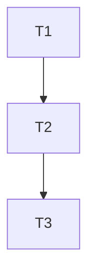

# Implementation Plan

**Feature:** Workspace

## Overview

Slice of `MASTER_SEQUENCING.md` owned by this spec.

## Task Dependency Graph



```json
{
  "waves": [
    {
      "wave": 1,
      "tasks": [1],
      "description": "Phase A \u2014 workspace scaffold"
    },
    {
      "wave": 2,
      "tasks": [2],
      "description": "Phase A \u2014 steering, spec skeletons, state files"
    },
    {
      "wave": 3,
      "tasks": [3],
      "description": "Phase A \u2014 tooling green on the skeleton and BLOCKING contradiction analysis (shared/07 A.5)"
    }
  ]
}
```

## Tasks

- [ ] **1. Scaffold the pnpm monorepo**
  - _Requirements: WS-1_
- [ ] **2. Steering, spec skeletons, state files**
  - _Requirements: WS-1_
- [ ] **3. Tooling green on the skeleton + contradiction analysis (BLOCKING)**
  - _Requirements: WS-1_

## Notes

Checkpoints block; update `.claude/state/progress.md` on completion.
