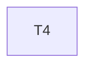

# Implementation Plan

**Feature:** Core: component contract and registry

## Overview

Slice of `MASTER_SEQUENCING.md` owned by this spec.

## Task Dependency Graph



```json
{
  "waves": [
    {
      "wave": 1,
      "tasks": [4],
      "description": "Phase B1 \u2014 core: contract keys, registry with scope resolution, errors"
    }
  ]
}
```

## Tasks

- [ ] **4. `@star-board/core`**
  - _Requirements: CORE-1_

## Notes

Checkpoints block; update `.claude/state/progress.md` on completion.
