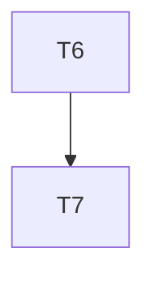

# Implementation Plan

**Feature:** Tokens and theme

## Overview

Slice of `MASTER_SEQUENCING.md` owned by this spec.

## Task Dependency Graph



```json
{
  "waves": [
    {
      "wave": 1,
      "tasks": [6],
      "description": "Phase B1 \u2014 spec loader/FeatureModel and tokens build; disjoint packages, both depend only on core"
    },
    {
      "wave": 2,
      "tasks": [7],
      "description": "Phase B1 checkpoint \u2014 fixture document loads, negative fixtures fail closed, tokens emit a theme"
    }
  ]
}
```

## Tasks

- [ ] **6. `@star-board/tokens`**
  - _Requirements: TOK-1_
- [ ] **7. Checkpoint B1**
  - _Requirements: TOK-1_

## Notes

Checkpoints block; update `.claude/state/progress.md` on completion.
