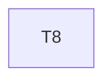

# Implementation Plan

**Feature:** Runtime: providers, client, hooks

## Overview

Slice of `MASTER_SEQUENCING.md` owned by this spec.

## Task Dependency Graph



```json
{
  "waves": [
    {
      "wave": 1,
      "tasks": [8],
      "description": "Phase B2 \u2014 runtime: providers, typed client, data hooks, capability gating, error presentation"
    }
  ]
}
```

## Tasks

- [ ] **8. `@star-board/runtime`**
  - _Requirements: RT-1_

## Notes

Checkpoints block; update `.claude/state/progress.md` on completion.
