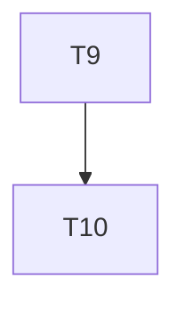

# Implementation Plan

**Feature:** Renderer: MUI

## Overview

Slice of `MASTER_SEQUENCING.md` owned by this spec.

## Task Dependency Graph



```json
{
  "waves": [
    {
      "wave": 1,
      "tasks": [9],
      "description": "Phase B3 \u2014 renderer-mui: one component per contract key, theme from tokens, stories"
    },
    {
      "wave": 2,
      "tasks": [10],
      "description": "Phase B3 checkpoint \u2014 every contract key has a renderer and a story; axe clean"
    }
  ]
}
```

## Tasks

- [ ] **9. `@star-board/renderer-mui`**
  - _Requirements: RND-1_
- [ ] **10. Checkpoint B3**
  - _Requirements: RND-1_

## Notes

Checkpoints block; update `.claude/state/progress.md` on completion.
