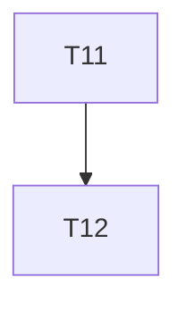

# Implementation Plan

**Feature:** Generator

## Overview

Slice of `MASTER_SEQUENCING.md` owned by this spec.

## Task Dependency Graph



```json
{
  "waves": [
    {
      "wave": 1,
      "tasks": [11],
      "description": "Phase B4 \u2014 generator: plan, emit types/zod/client/hooks, registry, routes"
    },
    {
      "wave": 2,
      "tasks": [12],
      "description": "Phase B4 \u2014 generator: default screens and override safety; drift check"
    }
  ]
}
```

## Tasks

- [ ] **11. `@star-board/generator` part 1**
  - _Requirements: GEN-1_
- [ ] **12. `@star-board/generator` part 2**
  - _Requirements: GEN-1_

## Notes

Checkpoints block; update `.claude/state/progress.md` on completion.
