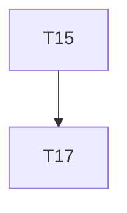

# Implementation Plan

**Feature:** Testing and parity

## Overview

Slice of `MASTER_SEQUENCING.md` owned by this spec.

## Task Dependency Graph



```json
{
  "waves": [
    {
      "wave": 1,
      "tasks": [15],
      "description": "Phase C \u2014 testing package (parity suite, msw from document, screen harness, page objects) and agent affordance (why panel, simulate\u2192apply over an MCP tool list); disjoint packages"
    },
    {
      "wave": 2,
      "tasks": [17],
      "description": "Phase C checkpoint \u2014 HARD GATE 1: parity green across REST/MCP/screens on the fixture; coverage; a11y; ratchet baseline committed"
    }
  ]
}
```

## Tasks

- [ ] **15. `@star-board/testing`**
  - _Requirements: TST-1_
- [ ] **17. Checkpoint C — HARD GATE 1**
  - _Requirements: TST-1_

## Notes

Checkpoints block; update `.claude/state/progress.md` on completion.
