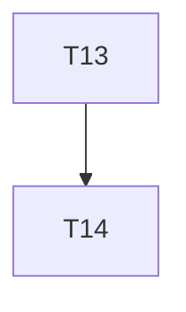

# Implementation Plan

**Feature:** CLI and example

## Overview

Slice of `MASTER_SEQUENCING.md` owned by this spec.

## Task Dependency Graph



```json
{
  "waves": [
    {
      "wave": 1,
      "tasks": [13],
      "description": "Phase B5 \u2014 cli generate|check and examples/petstore-ui wired to a Syntact petstore document"
    },
    {
      "wave": 2,
      "tasks": [14],
      "description": "Phase B5 checkpoint \u2014 petstore-ui boots from generate alone; full workflow E2E green with zero overrides"
    }
  ]
}
```

## Tasks

- [ ] **13. `@star-board/cli` + `examples/petstore-ui`**
  - _Requirements: CLI-1_
- [ ] **14. Checkpoint B5**
  - _Requirements: CLI-1_

## Notes

Checkpoints block; update `.claude/state/progress.md` on completion.
