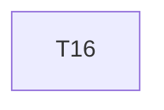

# Implementation Plan

**Feature:** Agent affordance

## Overview

Slice of `MASTER_SEQUENCING.md` owned by this spec.

## Task Dependency Graph



```json
{
  "waves": [
    {
      "wave": 1,
      "tasks": [16],
      "description": "Phase C \u2014 testing package (parity suite, msw from document, screen harness, page objects) and agent affordance (why panel, simulate\u2192apply over an MCP tool list); disjoint packages"
    }
  ]
}
```

## Tasks

- [ ] **16. Agent affordance**
  - _Requirements: AGT-1_

## Notes

Checkpoints block; update `.claude/state/progress.md` on completion.
