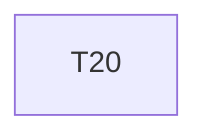

# Implementation Plan

**Feature:** Storybook and visual regression

## Overview

Slice of `MASTER_SEQUENCING.md` owned by this spec.

## Task Dependency Graph



```json
{
  "waves": [
    {
      "wave": 1,
      "tasks": [20],
      "description": "Phase D \u2014 overrides worked example in petstore-ui, Figma adapter (variables sync, Code Connect map, design permissions fragment), Storybook visual baselines; disjoint dirs"
    }
  ]
}
```

## Tasks

- [ ] **20. Storybook visual baselines**
  - _Requirements: VIS-1_

## Notes

Checkpoints block; update `.claude/state/progress.md` on completion.
