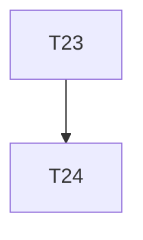

# Implementation Plan

**Feature:** Platform rules, examples, docs

## Overview

Slice of `MASTER_SEQUENCING.md` owned by this spec.

## Task Dependency Graph



```json
{
  "waves": [
    {
      "wave": 1,
      "tasks": [22, 23],
      "description": "Phase E \u2014 i18n, mobile/PWA and embedded-shell rules of typescript/05 applied to generated output; docs"
    },
    {
      "wave": 2,
      "tasks": [24],
      "description": "Phase E checkpoint \u2014 HARD GATE 2: CI green on main, publish dry-run"
    }
  ]
}
```

## Tasks

- [ ] **22. typescript/05 rules in generated output**
  - _Requirements: PLT-1_
- [ ] **23. Docs**
  - _Requirements: PLT-1_
- [ ] **24. Checkpoint E — HARD GATE 2**
  - _Requirements: PLT-1_

## Notes

Checkpoints block; update `.claude/state/progress.md` on completion.
