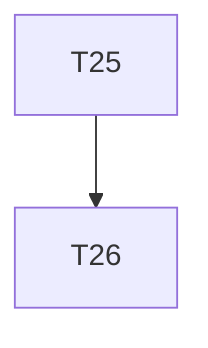

# Implementation Plan

**Feature:** Rules backfill

## Overview

Slice of `MASTER_SEQUENCING.md` owned by this spec.

## Task Dependency Graph



```json
{
  "waves": [
    {
      "wave": 1,
      "tasks": [25],
      "description": "Phase F \u2014 rules backfill: typescript/12 and shared/13 status to shipped, README lineage row, shared/02 \u00a71 drift table, typescript/01 tree confirmed"
    },
    {
      "wave": 2,
      "tasks": [26],
      "description": "Phase F checkpoint \u2014 rules cross-reference lint green, handoff"
    }
  ]
}
```

## Tasks

- [ ] **25. hexagonal-rules backfill**
  - _Requirements: RB-1_
- [ ] **26. Checkpoint F**
  - _Requirements: RB-1_

## Notes

Checkpoints block; update `.claude/state/progress.md` on completion.
